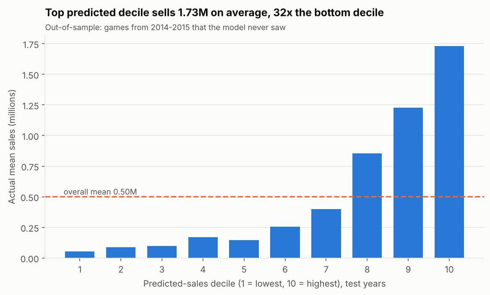

# Video Game Sales Prediction (Linear + Logistic Regression)

Predict **how many units a game will sell** (linear regression family) and **whether it will be a 1M+ hit**
(logistic regression), using ~15,000 games from VGChartz (1996-2015).
Everything is validated **by time** (train on the past, test on the future), the way a real forecast would be used.



## Results (held-out test: games released 2014-2015, never used for tuning)

**Regression: `log(1 + global sales)`**

| Model | CV RMSE (2009-13) | Test RMSE | Test R² | Test Spearman |
|---|---|---|---|---|
| Baseline (predict the mean) | 0.398 | 0.406 | -0.001 | 0.00 |
| Linear Regression (OLS) | 0.336 | 0.337 | 0.310 | 0.65 |
| **Ridge** (selected by CV) | **0.335** | **0.329** | **0.344** | **0.68** |
| Lasso | 0.335 | 0.339 | 0.302 | 0.65 |
| Elastic Net | 0.335 | 0.332 | 0.333 | 0.68 |
| Gradient Boosting (non-linear reference) | 0.322 | 0.325 | 0.360 | 0.67 |

- Ridge cuts test error **19%** vs the baseline and is within **0.004 RMSE** of gradient boosting, so a simple, explainable model captures almost everything the features can offer.
- Ranking is the strength: the games Ridge puts in its top decile sold **1.73M units on average vs 0.05M for the bottom decile (32x)**.

**Classification: is it a hit (>= 1M units)?** (12.1% of test games are hits)

| Metric | Logistic regression | Chance |
|---|---|---|
| ROC-AUC | **0.874** | 0.50 |
| PR-AUC (average precision) | **0.461** | 0.121 |
| Recall / precision / F1 at tuned threshold (0.23) | 0.79 / 0.37 / **0.50** | n/a |
| Precision in the top 10% of predictions | 0.47 | 0.12 |

The default 0.50 threshold gives F1 0.42 (recall only 0.35). The 0.23 threshold was chosen on out-of-fold validation data, not on the test set.
Cross-check: the *linear regression score* ranks hits almost as well (ROC-AUC 0.872), a useful sanity check that both models learn the same signal.

## What I'd say honestly about the results
- R² of 0.34 is **modest by design**: the dataset has no price, marketing budget, review scores or release month. These are the main drivers of whether a game sells. The model captures *who* publishes and *where/when* it is released, not *how good* the game is.
- Blockbusters are systematically **under-predicted** (see `06_pred_vs_actual.png`). Lifetime sales are heavy-tailed and a linear model on the log scale shrinks toward the mean.
- The data is VGChartz estimates (mostly physical retail) and ends in 2015, so the model says nothing about the digital era.

## How leakage was avoided
- **Time-based split**, not random: train 1996-2013, test 2014-2015.
- **Walk-forward cross-validation** for tuning: for each year 2009...2013, train on every earlier year, validate on that year.
- **Past-only features**: publisher track record and genre momentum use only sales from *earlier* release years (verified against a brute-force recomputation). Regional sales columns are never inputs, since they sum to the target.
- One-hot encoding and scaling are fitted **inside** each fold via a scikit-learn `Pipeline`.
- Model selection among the linear models uses CV error only. The test years are scored once at the end.
- Note: for the 2015 test games, the "publisher past sales" feature can use 2014 outcomes. That is realistic (you know last year's sales when predicting this year's releases) but it is a rolling, not a frozen, forecast.

## Project structure
```
analysis.py          <- notebook-style: 9 cells (# %%) to run step by step in VS Code
main.py              <- same pipeline, headless: python main.py   (about 3 minutes)
src/
  config.py          paths, time windows, hit threshold, chart palette
  data.py            load cleaned table, time split
  features.py        leakage-free features + preprocessing pipeline
  models.py          model candidates, walk-forward tuning, metrics
  pipeline.py        run_regression / run_classification / helpers
  plots.py           the 12 charts
  clean_vgsales.py   raw CSV -> normalised tables (data cleaning, run once)
data/raw             original Kaggle/VGChartz file
data/processed       cleaned + normalised tables (fact/dim), quarantine of rejected rows
outputs/             figures/, metrics.json, regression_results.csv, test_predictions.csv
reports/data_quality_report.md
```

## Run it
```bash
python -m venv .venv && source .venv/bin/activate     # Windows: .venv\Scripts\activate
pip install -r requirements.txt
python main.py                                         # everything, writes outputs/
```
**In VS Code:** install the *Python* and *Jupyter* extensions, open `analysis.py`, and click **Run Cell**
above any `# %%` line (or **Run All**). Charts appear in the Interactive window.
To rebuild the cleaned data from the raw file: `python src/clean_vgsales.py`.

## Data cleaning (summary)
16,598 raw rows -> 16,178 clean games (420 quarantined with a reason each: missing year, partial-region annotations such as "(US weekly sales)", impossible release years, duplicate keys). The table is normalised (one row per game x region in `fact_sales`, separate platform/genre/publisher lookups) and every output file is written atomically. Details: `reports/data_quality_report.md`.

## Resume bullets (numbers are from this repo's `outputs/metrics.json`)
- Built an end-to-end video-game sales prediction project on ~15K titles: normalised and cleaned a messy VGChartz scrape (16.6K to 16.2K rows, 420 quarantined with documented reasons) and engineered leakage-free features (publisher track record, platform life-cycle age, launch-year platform count).
- Trained and tuned Linear, Ridge, Lasso and Elastic Net regressions with **walk-forward (time-series) cross-validation**; the selected Ridge model cut held-out 2014-15 RMSE by **19% vs a mean baseline** (R² 0.34) and came within 0.004 RMSE of gradient boosting. Its top-decile predictions sold **32x** more than the bottom decile.
- Built a tuned logistic regression (L1/L2 and class-weight search, out-of-fold threshold selection) to flag 1M+ unit hits: **ROC-AUC 0.87, PR-AUC 0.46 vs 0.12 chance**, 79% recall on unseen games.
- Packaged as a reproducible Python project (modular `src/`, VS Code cell notebook, headless `main.py`, 12 publication-quality charts) with an honest limitations section.

## Interview talking points
- *Why not a random split?* It leaks same-year publisher/platform information; time splits mimic deployment.
- *Why log the target?* Sales are heavy-tailed (median 0.17M, max 82M); OLS assumptions fit the log scale far better.
- *Why is R² only 0.34?* Missing drivers (price, marketing, reviews). Showing this, plus the decile-lift chart, is more convincing than a leaked 97%.
- *Why a lower threshold?* Hits are 12% of games; maximising F1 on out-of-fold predictions favours recall (0.23 vs 0.50).
- *Why include gradient boosting?* As a ceiling check: the linear model is within 0.004 RMSE, so the extra complexity isn't worth it here.
